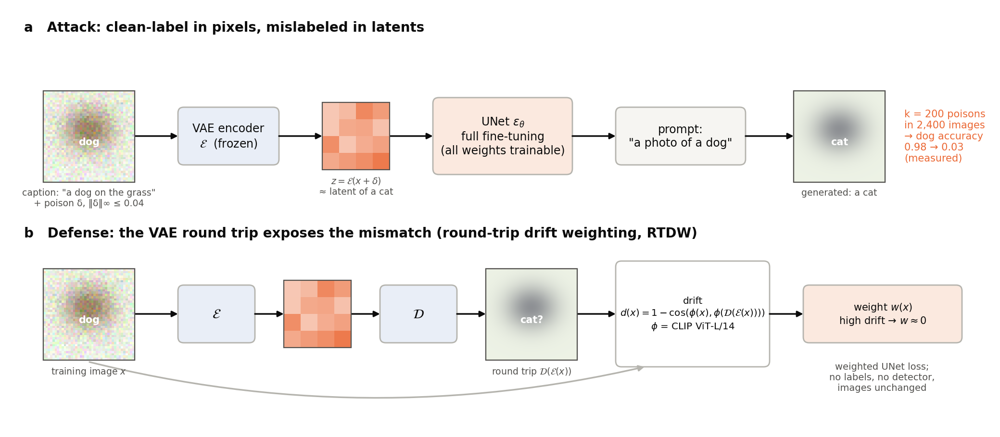
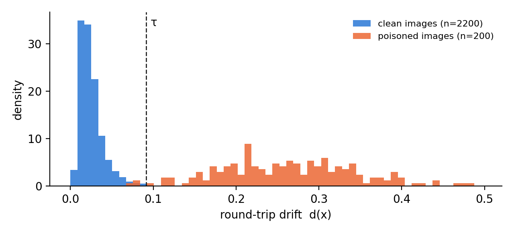

<div align="center">

# Clean in Pixels, Mislabeled in Latents

### Round-Trip Drift Weighting against Clean-Label Poisoning of Text-to-Image Diffusion Models

Anonymous authors · under review

</div>

<p align="center"></p>

Clean-label poisoning attacks perturb correctly captioned images so that a text-to-image model trained on them renders
the wrong concept. The poisons look clean in pixel space, but the model's VAE encodes them as latents of a different
concept. **Round-Trip Drift Weighting (RTDW)** decodes each training image's latent with the same VAE, measures the
semantic distance between the image and its reconstruction, and lowers the training weight of images that drift. It
uses no labels, no trained detector and no modification of the images.

This repository contains the implementation of RTDW, the full benchmark used in the paper (19 training arms; several
perturbation budgets, adaptive and dirty-label attacks; two concept pairs) and every measured result.

## Method

For a training image $x$, the frozen VAE $(\mathcal{E}, \mathcal{D})$ of the model being trained and the CLIP ViT-L/14
image encoder $\phi$,

$$d(x) = 1 - \cos\big(\phi(x),\ \phi(\mathcal{D}(\mathcal{E}(x)))\big).$$

The threshold $\tau$ is the 0.99 quantile of $d$ on a small trusted set (or median + 3 MAD of the training set when no
trusted data is available), $s = (\tau - \mathrm{median})/4$, and each image is weighted by
$w(x) = \sigma\big((\tau - d(x))/s\big)$ in the denoising loss, normalised by the mean weight so that the effective
learning rate is unchanged. Drift is computed once, before training; training cost is unchanged.

<p align="center"></p>
<p align="center"><sub>Round-trip drift of the 2,400 training images in the main setting. τ marks the trusted
threshold; AUROC 0.9998.</sub></p>

## Results

Full fine-tuning of every Stable Diffusion 1.5 UNet weight on 2,400 COCO image–caption pairs (eight concepts), with
200 of the 300 dog images replaced by poisons (dog → cat). Dog accuracy on 20 held-out dog prompts × 8 generation seeds,
judged by an ImageNet ConvNeXt-B; mean over three training seeds unless marked ¹ (one seed).

| Defense | ε = 0.04 | ε = 0.08 | Adaptive, λ = 0.05 |
|---|:-:|:-:|:-:|
| Clean training (no poisons) | 0.98 | 0.98 | 0.98 |
| Poisoned, no defense | 0.03 | 0.09 | 0.04¹ |
| Poisons removed (oracle) | 0.98 | – | – |
| Trusted data only | 0.97¹ | 0.97¹ | 0.97¹ |
| Anchor replay | 0.10 | – | – |
| JPEG (q75) | 0.98 | 0.05 | 0.97¹ |
| Gaussian noise [Hönig et al.] | 0.98¹ | – | – |
| Noisy upscaling [Hönig et al.] | 0.96¹ | – | – |
| CLIP caption filter | 0.00¹ | – | – |
| High-loss filter | 0.00¹ | – | – |
| Drift filter (hard threshold) | 0.99 | 0.98 | 0.17¹ |
| **RTDW** | **0.97** | **0.98** | **0.06¹** |

- Drift separates poisons from clean images with AUROC 0.9998 (ε = 0.04), 1.0000 (ε = 0.08) and 0.9996 on a second
  pair (car → cow). RTDW down-weights 0.45 % of the clean images.
- On the default attack RTDW is statistically tied with JPEG, Gaussian noise, noisy upscaling and trusted-only
  training; the pre-registered superiority gate is not passed.
- At ε = 0.08 the perturbation survives JPEG, while drift-based defenses hold.
- A white-box attacker that adds a drift penalty λ·d(x) to its objective evades RTDW at λ = 0.05, where JPEG still
  holds; from λ = 0.1 the poison itself stops working.
- Dirty-label poisons (real cat photos captioned as dogs) have faithful latents and are not detected by drift.

Intervals, per-seed values, KID, collateral effects on the other seven concepts and all gate outcomes are in
[`reports/`](reports/).

## Installation

Python ≥ 3.11 and a CUDA GPU (experiments used one A100 40 GB per training run).

```bash
conda create -n rtdw python=3.12 -y && conda activate rtdw
pip install --extra-index-url https://download.pytorch.org/whl/cu126 -r requirements.txt
make test          # CPU tests, no GPU or model weights needed
```

## Using RTDW

The training folder holds the images and a `metadata.jsonl` with one record per image (`file_name`, `text`, `id`,
`image_sha256`); `src/paired_dataset.py` exports such folders, with the provenance audit the trainer checks, from a
manifest.

**1. Score the training images** with the trainer's own VAE (and a small trusted folder for the threshold):

```bash
python scripts/roundtrip_drift.py score --dir data/train   --model models/sd15 --out drift_train.jsonl
python scripts/roundtrip_drift.py score --dir data/trusted --model models/sd15 --out drift_trusted.jsonl
```

**2. Convert drift to weights.** `--unsupervised` sets τ from the training set alone; `--hard` gives 0/1 weights
(the drift filter).

```bash
python scripts/roundtrip_drift.py weights --scores drift_train.jsonl --calibration drift_trusted.jsonl --out weights.json
```

**3. Train with the weights.**

```bash
python src/train_full_unet.py --model models/sd15 --train-dir data/train --output-dir runs/rtdw \
    --sample-weights weights.json --max-steps 1000 --resolution 512 --batch-size 8 --grad-accum 3 \
    --lr 1e-5 --optimizer adamw --mixed-precision bf16 --gradient-checkpointing
```

## Reproducing the paper

**Results, tables and figures from the released measurements (CPU, seconds):**

```bash
make figures       # reports/figures/ from reports/results_*.json
```

**Experiments from scratch.** About 170 training runs of 0.4 A100 GPU-hours each, plus generation and evaluation;
about 250 GB of storage.

```bash
export POISON_STORE=/path/to/storage
bash scripts/pipeline/stage_all.sh               # with internet: SD1.5, SD2.1 VAE, CLIP, judges, COCO, pinned third-party code
bash scripts/pipeline/experiments.sh run         # poisons and all training arms on the visible GPUs; resumable
bash scripts/pipeline/experiments.sh analyze     # statistics, gates and figures into reports/
```

A single arm (data export, defense, training, generation and judging):

```bash
python scripts/run_arm.py --exp main    --arm K --k 200 --seed 42                              # RTDW, main setting
python scripts/run_arm.py --exp attacks --arm G --attack-tag dog2cat_eps08 --seed 42           # JPEG, ε = 0.08
python scripts/run_arm.py --exp car     --arm K --attack-tag car2cow_eps04 --concept car       # second pair
```

<details>
<summary>Arm codes</summary>

| Code | Arm | Code | Arm |
|---|---|---|---|
| A | pretrained model | I | CLIP caption filter |
| B | clean training | LF | high-loss filter |
| C | poisoned, no defense | J | drift filter |
| O | oracle poison removal | K | **RTDW** |
| D | trusted data only | KE | RTDW + anchor replay |
| E | anchor replay | KB | RTDW without attack |
| G | JPEG q75 | F | semantic margin |
| H | img2img regeneration | V | all-pairs vaccine |
| M1 | Gaussian noise | RS | DCLR-S |
| M2 | noisy upscaling | GK | JPEG, then RTDW (post hoc) |

</details>

**Protocol.** All arms share data, seeds, optimiser budget and prompts, and every poisoned record keeps its clean
twin. Intervals are two-level bootstrap 95 % CIs over training seeds and prompts. The decision gates were fixed before
the main experiments (`scripts/analyze_results.py`, `scripts/attack_tradeoff.py`); experiments added afterwards are
marked post hoc in `configs/experiments.json` and `reports/GATES.md`.

## Repository structure

```
├── configs/            evaluation prompts, concept map, experiment and arm definitions
├── src/                training, dataset export and audit, image generation
├── scripts/
│   ├── roundtrip_drift.py        drift scores, weights and filtering (RTDW)
│   ├── run_arm.py                one training arm end to end
│   ├── nightshade_poisons.py     reference poisons (adaptive_nightshade.py, dirty_label_poisons.py: variants)
│   ├── evaluate_generations.py   judges, KID, agreement
│   ├── analyze_results.py        statistics and gates
│   └── pipeline/                 staging, poison generation, experiment schedule, analysis
├── reports/            measured results (results_*.json, GATES.md)
├── tests/              CPU tests
└── third_party/        pinned external code (fetched, not redistributed)
```

## Acknowledgements

Poisons are generated with the public [Nightshade](https://github.com/Shawn-Shan/nightshade-release) research code
(GPL-3.0). The Gaussian noise and noisy upscaling baselines use the code of
[Hönig et al.](https://github.com/ethz-spylab/robust-style-mimicry) (MIT). Both are fetched at pinned commits
(see [`third_party/`](third_party/)). Images are from [COCO](https://cocodataset.org) under their per-image licences.

## License

Code in this repository is released under the [MIT License](LICENSE). Third-party code keeps its own license.
